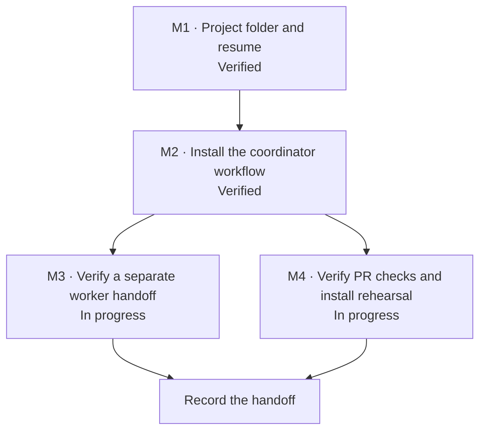

# Shared PM workflow roadmap

- [M1 Project folder and resume](checklist.md#m1-project-folder-and-resume)
- [M2 Install the coordinator workflow](checklist.md#m2-install-the-coordinator-workflow)
- [M3 Verify a separate worker handoff](checklist.md#m3-verify-a-separate-worker-handoff)
- [M4 Verify PR checks and install rehearsal](checklist.md#m4-verify-pr-checks-and-install-rehearsal)
